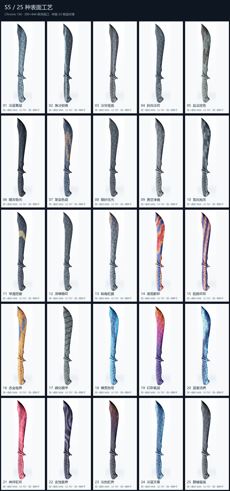

# S5 Chrome 移动端截图

真实 Chrome 156 / 390×844 / DPR 2（渲染器自适应 DPR 1.5）；独立测试存档。

[25 卡总览](s5-25-cards.jpg) · [25 卡改前改后](s5-before-after.jpg) · [24 种 S3 锻纹](s3-24-textures.jpg) · [稀有构图](s5-rare-patterns.jpg) · [跨局变化](s5-seed-variation.jpg)

| 卡牌 | 完整手机画面 |
| --- | --- |
| S5_01 | [查看 Chrome 原始比例截图](cards/S5_01.jpg) |
| S5_02 | [查看 Chrome 原始比例截图](cards/S5_02.jpg) |
| S5_03 | [查看 Chrome 原始比例截图](cards/S5_03.jpg) |
| S5_04 | [查看 Chrome 原始比例截图](cards/S5_04.jpg) |
| S5_05 | [查看 Chrome 原始比例截图](cards/S5_05.jpg) |
| S5_06 | [查看 Chrome 原始比例截图](cards/S5_06.jpg) |
| S5_07 | [查看 Chrome 原始比例截图](cards/S5_07.jpg) |
| S5_08 | [查看 Chrome 原始比例截图](cards/S5_08.jpg) |
| S5_09 | [查看 Chrome 原始比例截图](cards/S5_09.jpg) |
| S5_10 | [查看 Chrome 原始比例截图](cards/S5_10.jpg) |
| S5_11 | [查看 Chrome 原始比例截图](cards/S5_11.jpg) |
| S5_12 | [查看 Chrome 原始比例截图](cards/S5_12.jpg) |
| S5_13 | [查看 Chrome 原始比例截图](cards/S5_13.jpg) |
| S5_14 | [查看 Chrome 原始比例截图](cards/S5_14.jpg) |
| S5_15 | [查看 Chrome 原始比例截图](cards/S5_15.jpg) |
| S5_16 | [查看 Chrome 原始比例截图](cards/S5_16.jpg) |
| S5_17 | [查看 Chrome 原始比例截图](cards/S5_17.jpg) |
| S5_18 | [查看 Chrome 原始比例截图](cards/S5_18.jpg) |
| S5_19 | [查看 Chrome 原始比例截图](cards/S5_19.jpg) |
| S5_20 | [查看 Chrome 原始比例截图](cards/S5_20.jpg) |
| S5_21 | [查看 Chrome 原始比例截图](cards/S5_21.jpg) |
| S5_22 | [查看 Chrome 原始比例截图](cards/S5_22.jpg) |
| S5_23 | [查看 Chrome 原始比例截图](cards/S5_23.jpg) |
| S5_24 | [查看 Chrome 原始比例截图](cards/S5_24.jpg) |
| S5_25 | [查看 Chrome 原始比例截图](cards/S5_25.jpg) |

原始运行记录：[Chrome](chrome-mobile-report.json)、[基线性能](benchmark-before.json)、[升级后性能](benchmark-after.json)、[像素审查](visual-audit.json)。
